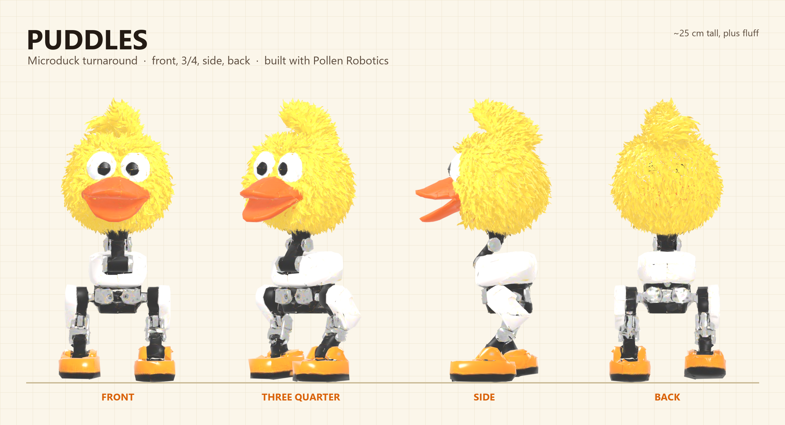

<div align="center">


# Puddles

**The wobbly little Microduck on a mission to splash some joy.**
<br>He falls over a lot. He gets back up every time.

[](https://puddlesdaily.com) [](https://x.com/PuddlesDaily) [](https://pollen-robotics.com/microduck/) [](https://github.com/pollen-robotics/microduck) [](https://huggingface.co/spaces/pollen-robotics/microduck-simulator)

**Dev address:** `3MQKtbfNqCXKBq8UgXWEJnpEoNFX4NeNF5RRhq9sifsD`

</div>

---

## About

**Puddles** is a real, walking robot: a [Pollen Robotics Microduck](https://pollen-robotics.com/microduck/) wearing a handmade, fluffy duckling puppet for a head. He's 25 cm tall, plus fluff, and he's touring the States one puddle at a time.

Underneath the fluff is one of the most hackable little robots ever made. The Microduck is an open-source biped from Pollen Robotics, the robotics team at Hugging Face. **Every move it makes is a learned AI policy you can retrain, change and share.** Puddles walks, falls, gets back up and learns new tricks the same way every Microduck does: by practising in simulation thousands of times, then trying it for real.

This repository is Puddles' **official character bible**: the single source of truth for anyone who wants to write, draw, animate, puppeteer, film, program or run Puddles and have him stay himself. It holds his personality and rules, his look, the hardware he runs on, and production-ready 3D and 2D assets.

> *"Every puddle is a pond, and every pond is the ocean."*

---

## Character Design

<p align="center">
  
</p>

The **2D mascot design**: a full turnaround (front, 3/4, side, back, top), a 400×400 avatar with his little neckerchief, and five core expressions. Use this version for illustration, stickers, emotes, avatars, merch and 2D animation, where Puddles is allowed to emote with his face.

**Design notes**
- **Silhouette:** a round, fluffy head that's bigger than his body, with a three-feather tuft on top. He should read instantly in silhouette from any angle.
- **Colours:** soft duckling yellow fluff, a bright orange beak and feet, and black and white eyes. The robot body is white with black joints.
- **Eyes:** big, round and slightly mismatched. They do most of the acting in 2D.
- **Line:** thick, friendly black outlines and a slightly scruffy feather edge. Never sleek.

| Expression | Use it for |
|---|---|
| Happy | Default. Greetings, posts, avatars. |
| Laughing | Wins, jokes, good news, milestones. |
| Surprised | Reveals, announcements, "whoa!" moments, right before a fall. |
| Smug | Teasers, playful confidence, "told you I'd get back up". |
| Sleepy | Goodnight posts, off-hours, battery low, "back soon". |

> **2D vs. real:** the cartoon Puddles can open his bill and pull faces. The **real** Puddles (robot + puppet) can't: his googly eyes and felt bill never move, and all his feeling comes through his body. Don't mix the two rules up. See [Drawing & Filming Him](bible.md#drawing--filming-him).

---

## At a Glance

| | |
|---|---|
| **Name** | Puddles |
| **Species** | Microduck: a bipedal robot with a duckling puppet head |
| **Built with** | [Pollen Robotics](https://pollen-robotics.com/microduck/), the robotics team at Hugging Face |
| **Height** | 25 cm, plus fluff |
| **Brain** | AI policies trained with reinforcement learning, running on board |
| **Software** | Open source, Apache 2.0 ([pollen-robotics/microduck](https://github.com/pollen-robotics/microduck)) |
| **Personality** | Endlessly optimistic, curious, brave, very wobbly |
| **Voice** | Never talks. Quacks, wiggles and dramatic falls. |
| **Signature move** | The fall: stumble, faceplant, kick, push up, wobble, quack, carry on |
| **Rules** | Wobble. Get up. Splash. |
| **Catchphrases** | Quack! · Quack quack! · Whoa! · oof |
| **Fears** | Stairs, vacuum cleaners, droughts |

---

## What Is a Microduck?

The **Microduck** is a small, open-source, two-legged robot made by [Pollen Robotics](https://pollen-robotics.com/microduck/) (part of [Hugging Face](https://huggingface.co)), announced in August 2026. It's built to be a robot you can **teach**, not just a robot that does what it was shipped with.

| Spec | Microduck |
|---|---|
| **Height** | 25 cm |
| **Weight** | ~800 g |
| **Motors** | 15 |
| **Sensors** | Camera, LiDAR, two IMUs (balance sensors) |
| **Gripper** | An articulated beak that scoops things off the floor |
| **Brain** | AI policies running on board at 50 Hz |
| **Battery** | Swappable; about an hour of play per charge |
| **Controls** | Game controller in the box, plus a command-line tool over SSH |
| **Software** | SDK, simulator and full reinforcement-learning stack, open source under Apache 2.0 |
| **Price** | $399 (introductory) |

Puddles is a Microduck with a costume and a personality. Everything the hardware can do, Puddles can do, in his own wobbly way.

---

## What Puddles Can Do

Every Microduck ships with seven trained moves. Here's how each one looks when Puddles does it:

| Skill | What the robot does | How Puddles does it |
|---|---|---|
| **Walk** | Velocity-tracking gait, steered with the controller | Quick, short, shuffling steps, rocking side to side, always heading for the nearest puddle |
| **Get back up** | From flat on its back to standing, by itself | His signature move. Falls over, kicks his legs, pushes up, wobbles, quacks, carries on |
| **Sit & stand** | Sits down, holds the pose, stands back up on its own | Sits to watch the rain, then pops back up when something interesting happens |
| **Kick** | A one-shot kick, then straight back to walking | Kicks pebbles, leaves and the occasional ball into puddles |
| **Grab** | Dips the beak to the ground, scoops, pops back upright | Picks up treasures: bottle caps, leaves, socks |
| **Roller skate** | Skates when the rollers are fitted | Very fast, very wobbly, very proud of himself |

> **The fall is real.** Most robots are shown never putting a foot wrong. The Microduck was designed to fall, recover and keep going. Hugging Face's CEO said it "can walk, pick things up, get back up when it falls, and even roller-skate." That's the whole Puddles story, built into the hardware.

---

## Teach Puddles New Tricks

This is what makes Puddles different from a toy. **Every behaviour is an AI policy you can retrain on your own machine.** If you can imagine a move, you can teach it to him.

1. **Train in simulation.** Each Microduck has a simulated twin in [MuJoCo](https://mujoco.org), a physics simulator. Reinforcement learning lets the virtual duck try a move thousands of times, falling over and getting rewarded when it gets closer, until it works. You can train on your own computer or in the cloud on Hugging Face Jobs.
2. **Deploy to the robot.** Load the trained policy onto the real Microduck. The same brain that learned in the sim now drives the real motors (this is called *sim-to-real*).
3. **Refine.** Watch what the real robot does differently, tweak the simulation, and train again.
4. **Share.** Publish your policy so every other Microduck owner can install it on their robot.

You can try the **[Microduck simulator in your browser](https://huggingface.co/spaces/pollen-robotics/microduck-simulator)** without owning one, and talk to other builders in the [Pollen Robotics Discord](https://discord.com/invite/pollen-community-519098054377340948).

**Tricks we'd love to see Puddles learn:** a happy waddle-dance, splashing in puddles on purpose, a dramatic slow-motion faceplant, waving with one foot, following a laser pointer, and finding his way home from the end of the hall.

---

## Open Source

Puddles runs on an open stack. What the robot runs is what you can read, fork and retrain.

- **Microduck software:** [github.com/pollen-robotics/microduck](https://github.com/pollen-robotics/microduck). The SDK, the MuJoCo simulation and the full reinforcement-learning training stack, Apache 2.0.
- **Browser simulator:** [huggingface.co/spaces/pollen-robotics/microduck-simulator](https://huggingface.co/spaces/pollen-robotics/microduck-simulator)
- **Puddles assets (this repo):** his character bible, 3D model with walk cycle, and character art, so anyone can animate him, render him or build him into a game.

---

## 3D Model

<p align="center">
  
</p>

The real Puddles in 3D. He was scanned from the physical robot with his puppet head on, cleaned up, cut down to about 42,000 faces, and rigged in Blender with a looping walk cycle. It's the same model that walks across the planet on [puddlesdaily.com](https://puddlesdaily.com).

| File | Format | Use it for |
|---|---|---|
| [`3d/puddles.blend`](3d/puddles.blend) | Blender | Animation, renders, posing. Textures packed in. |
| [`3d/puddles.glb`](3d/puddles.glb) | glTF 2.0 | Websites, games, three.js, Unity, Unreal, Godot. Walk cycle included. |
| [`3d/puddles.usdz`](3d/puddles.usdz) | USDZ | Open on an iPhone or iPad to put Puddles in your room in AR. |

**The rig:** each leg is split into a thigh, shin and foot, hung from hip, knee and ankle joints. The root carries a body bob and a side-to-side waddle. The walk is a one-second stride that loops forever. Scale is 1 unit ≈ 10 cm (he's about 2.6 units tall).

**Quick start (three.js):**

```js
new THREE.GLTFLoader().load('puddles.glb', (gltf) => {
  scene.add(gltf.scene);
  const mixer = new THREE.AnimationMixer(gltf.scene);
  gltf.animations.forEach((clip) => mixer.clipAction(clip).play()); // walk cycle
  // call mixer.update(delta) every frame
});
```

> This model is a visual likeness for animation, games and the web. It isn't the Microduck's simulation model. For training policies, use the MuJoCo model in [pollen-robotics/microduck](https://github.com/pollen-robotics/microduck).

More detail is in [`3d/README.md`](3d/README.md).

---

## The Character Bible

[`bible.md`](bible.md) is the heart of this repo. Read it before you write, draw, film or program anything with Puddles in it. It covers:

- **The Three Splashes:** *Wobble. Get up. Splash.* The three ideas he steers by when things get hard.
- **The Practice:** how we build him feet first, borrowing from silent-film clowns and the classic principles of animation, since his face can't move.
- **The Character Sheet:** name, origin, body, diet, education, job, beliefs, goals, fears, catchphrases and special traits.
- **Analysis:** his archetype (part ugly duckling, part toddler, part silent-film clown), his personality, and how he moves, including the step-by-step anatomy of *the fall*.
- **Philosophy:** why a robot that falls over is the most honest robot there is. Real walking robots learn by falling, and Puddles doesn't hide it.
- **Drawing & Filming Him:** the do's and don'ts for real footage, renders and art.
- **How Puddles Treats People:** walks toward people, never asks for anything.

[`values.md`](values.md) is a growing, dated log of who he is becoming: small rules and moments that define him, added as he grows.

---

## Support Puddles

Puddles is community-powered.

- **Follow the tour** at [puddlesdaily.com/tour](https://puddlesdaily.com/tour): schools, parties, parks and tech events across the States.
- **Vote** for him to waddle into your town.
- **Send him a treat** at [puddlesdaily.com/wallet](https://puddlesdaily.com/wallet).
- **Follow** [@PuddlesDaily](https://x.com/PuddlesDaily) for daily wobbles.

---

## Credits

- **Robot:** [Microduck](https://pollen-robotics.com/microduck/) by [Pollen Robotics](https://pollen-robotics.com) / [Hugging Face](https://huggingface.co)
- **Head:** handmade faux-fur duckling puppet
- **Character:** Puddles, [@PuddlesDaily](https://x.com/PuddlesDaily)

---

<div align="center">

**[puddlesdaily.com](https://puddlesdaily.com)** · **[@PuddlesDaily](https://x.com/PuddlesDaily)**

*Wobble. Get up. Splash.* 🐥

</div>
